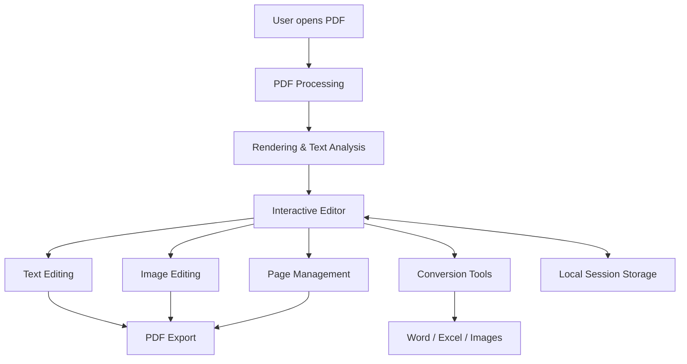

 <div align="center">

<br />

# PDF Studio

### A better way to work with PDFs.

A browser-based PDF editor focused on **precision, privacy, and keeping documents intact.**

Edit text, manage pages, convert files, and work with PDFs — all from one workspace, without sending your documents to a processing server.

<br />

<p>
  
  
  
</p>

<p>
  <a href="https://github.com/DevDarsh26/PDF-Studio">
    
  </a>
  <a href="https://darshmodii.in">
    
  </a>
</p>

<br />

</div>

---

## ✨ Features

### 01. Text Editing

- Edit existing text directly within a PDF.
- Work with PDF text operators such as `Tj` and `TJ`.
- Preserve text positioning, baselines, and formatting as closely as possible.
- Combine fragmented text into more usable editing selections.

### 02. Image Editing

- Select embedded images, logos, and graphics.
- Move, resize, and replace images.
- Maintain aspect ratio while resizing.
- Adjust opacity and position.

### 03. Page Management

- Reorder pages with drag and drop.
- Rotate pages.
- Duplicate or delete pages.
- Insert blank pages.
- Merge multiple PDFs and split documents.

### 04. Conversion Tools

- Convert PDF content into Word documents.
- Export tables to Excel or CSV.
- Export pages as PNG or JPG.
- Download image exports in a ZIP archive.

### 05. Additional Tools

- Password protection and encryption.
- Flatten PDF documents.
- Add watermarks and stamps.
- Manage document pages and content.

### 06. Responsive Interface

PDF Studio is designed to work across different screen sizes, with a desktop workspace for detailed editing and a more touch-friendly layout for smaller devices.

---

## 🛠️ Tech Stack

PDF Studio combines several technologies to handle PDF rendering, editing, and document processing.

| Technology | Purpose |
|---|---|
| React 19 | User interface |
| Tailwind CSS | Styling and layout |
| pdfjs-dist | PDF rendering and text extraction |
| pdf-lib | PDF manipulation and exporting |
| WebAssembly | Browser-side processing support |
| IndexedDB | Local document session persistence |

---

## 🏗️ Architecture

The application separates document rendering, editing, conversion, and local persistence into different parts of the workflow.



---

## ⌨️ Keyboard Shortcuts

| Shortcut | Action |
|---|---|
| `V` | Select / Pointer tool |
| `E` | Edit existing text |
| `T` | Add new text |
| `Space` | Hold to pan |
| `Arrow Keys` | Move selected element |
| `Shift + Arrow Keys` | Move selected element faster |
| `Ctrl / Cmd + D` | Duplicate selection |
| `Ctrl / Cmd + Z` | Undo |
| `Ctrl / Cmd + Y` | Redo |
| `Ctrl / Cmd + 0` | Reset zoom |
| `+ / -` | Zoom in / out |
| `Esc` | Deselect |

---

## 🚀 Getting Started

### Prerequisites

Make sure you have the following installed:

- Node.js 18.18+ or Node.js 20+
- npm or pnpm

### Installation

**1. Clone the repository**

```bash
git clone https://github.com/DevDarsh26/PDF-Studio.git
cd PDF-Studio
```

**2. Install dependencies**

```bash
npm install
```

**3. Start the development server**

```bash
npm run dev
```

**4. Open the application**

Visit the local URL displayed in your terminal, usually:

```text
http://localhost:3000
```

### Running Tests

Run the test suite:

```bash
npm test
```

Run tests in watch mode:

```bash
npm run test:watch
```

### Production Build

```bash
npm run build
npm run start
```

---

## 🔒 Privacy

PDF Studio is designed around local document processing.

- Documents are processed within the browser.
- Files are not intentionally uploaded to a PDF processing server.
- Document sessions can be stored locally using IndexedDB.
- No document-processing backend is required for the core workflow.

The application may still load external libraries or other resources depending on its configuration. Local processing of a PDF does not necessarily mean the entire application is fully offline.

---

## 📄 License

This project is open-source under the **MIT License**.

See the [LICENSE](LICENSE) file for more information.

---

<div align="center">

## 👨‍💻 Built by Darsh Modi

An independent project exploring PDF rendering, document editing, browser-side processing, and the challenges of working with PDF internals.

<br />

[**Portfolio**](https://darshmodii.in) · [**GitHub**](https://github.com/DevDarsh26)

<br />

<sub>Thanks for checking out PDF Studio!</sub>

</div>
