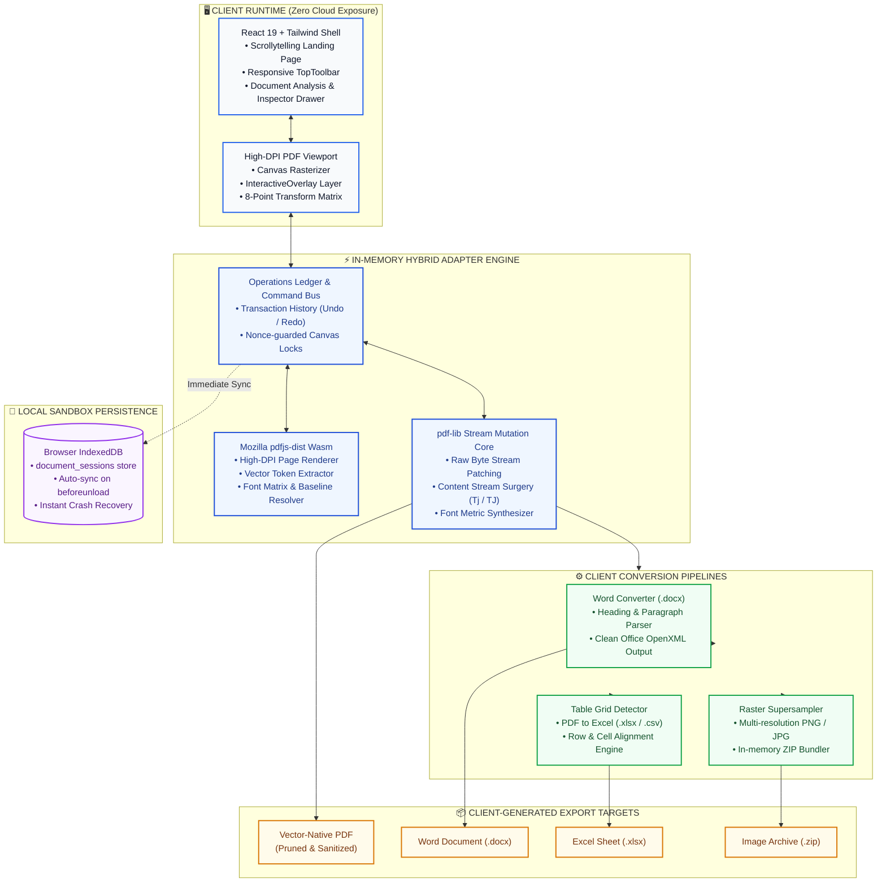
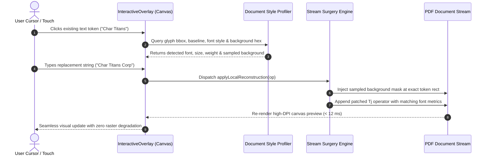

<div align="center">

# PDF STUDIO

### Professional In-Browser Vector PDF Studio & Content Stream Engine
**100% Client-Side WebAssembly &bull; Zero Server Calls &bull; Zero Raster Degradation**

<br/>

[](https://darshmodii.in)
[](https://darshmodii.in)
[](https://github.com/DevDarsh26)
[](src/)
[](tsconfig.json)
[](package.json)
[](#-air-gapped-security-contract)
[](LICENSE)

<br/>

```
┌───────────────────────────────────────────────────────────────────────────────┐
│  [Open PDF]    ──►  [Parse Stream]   ──►  [Vector Edit]   ──►  [Save & Export]│
│   instant drop       pdfjs-dist Wasm       Tj / TJ surgery      pdf-lib core  │
│   0-byte upload      in-memory tab         true vector          clean output  │
└───────────────────────────────────────────────────────────────────────────────┘
```

</div>

---

## ⚡ Overview

**PDF Studio** is a high-accuracy, 100% browser-based PDF workstation designed to eliminate privacy vulnerabilities and rasterization artifacts inherent in conventional web PDF editors.

Traditional online editors upload confidential files to cloud servers, render low-resolution bitmaps, and paste loose HTML overlays. **PDF Studio executes entirely in local WebAssembly memory**, performing direct byte surgery on raw PDF content streams while preserving vector fidelity, font matrices, baselines, and exact physical page dimensions.

---

## ✨ Signature Capabilities

### 1. Direct Content Stream Surgery (True Vector Editing)
- Modifies existing textual content within PDF binary streams (`Tj` and `TJ` operators) instead of masking text with coarse HTML rectangles.
- Retains authentic document fonts, kerning, baselines, and vector sharpness at any magnification (100% to 500%).
- Smart token adjacency analysis automatically joins adjacent glyph fragments (e.g. *Char Titans*) into clean editable blocks.

### 2. In-Place Canvas Background Sampling
- Automatically samples the exact background color of the document page at text coordinates.
- Warm paper, parchment, invoices, and tinted forms maintain chromatic consistency when edited, eliminating harsh white patch rectangles.

### 3. Logo & Image Extraction, Resizing & Replacement
- Click on any embedded logo, graphic, or photo to isolate and edit it.
- Full 8-handle transform box with real-time aspect ratio lock, smooth drag translation, opacity tuning, and instant file replacement.

### 4. 24 Integrated Client-Side PDF Tools
- **Organize & Page Flow**: Reorder pages, rotate clockwise/counter-clockwise, duplicate, delete, and insert blank pages.
- **Merge & Split**: Combine multiple documents into one or partition large PDFs by page ranges.
- **Conversion Pipelines**: Client-side document conversion into Microsoft Word (`.docx`), Excel spreadsheets (`.xlsx` / `.csv`), and high-DPI image bundles (`.png` / `.jpg` in `.zip`).
- **Security & Watermarking**: Encrypt with standard passwords, flatten documents, and apply custom vector stamps.

### 5. Multi-Device Responsive Architecture
- **Desktop (1024px+)**: Unified top navigation, vertical 72px tool rail, collapsible 172px thumbnail strip, and 310px document inspector.
- **Tablet & Mobile (< 768px)**: Horizontal thumb-accessible tool strip, slide-out drawer navigation with tap-outside dismissals, and full Pointer/Touch event support for iPad, stylus, and touchscreens.

---

## 🧭 System Architecture



---

## ⚡ Direct Stream Mutation Flow



---

## ⌨️ Productivity Keyboard Shortcuts

| Shortcut | Action | Scope | Description |
| :--- | :--- | :--- | :--- |
| <kbd>V</kbd> | **Select / Pointer** | Canvas | Activate pointer for selecting, moving, and resizing elements |
| <kbd>E</kbd> | **Edit Existing Text** | Canvas | Target and modify original text glyphs directly on page |
| <kbd>T</kbd> | **Add New Text** | Canvas | Insert editable vector text at cursor position |
| <kbd>Space</kbd> | **Hand / Pan (Hold)** | Universal | Hold from *any* active tool to pan smoothly across the canvas |
| <kbd>↑</kbd> <kbd>↓</kbd> <kbd>←</kbd> <kbd>→</kbd> | **Fine Nudge** | Selection | Precision sub-millimeter position adjustment (1 pt increment) |
| <kbd>Shift</kbd> + <kbd>Arrows</kbd> | **Coarse Nudge** | Selection | Rapid element positioning (10 pt increments) |
| <kbd>Ctrl</kbd> / <kbd>⌘</kbd> + <kbd>D</kbd> | **Duplicate** | Selection | Clone active element with a clean 15 pt offset |
| <kbd>Ctrl</kbd> / <kbd>⌘</kbd> + <kbd>Z</kbd> | **Undo** | Global | Revert previous action in transaction ledger |
| <kbd>Ctrl</kbd> / <kbd>⌘</kbd> + <kbd>Y</kbd> | **Redo** | Global | Replay next action in history stack |
| <kbd>Ctrl</kbd> / <kbd>⌘</kbd> + <kbd>0</kbd> | **Reset Zoom** | Viewport | Reset viewport zoom to 100% |
| <kbd>+</kbd> / <kbd>-</kbd> | **Zoom Step** | Viewport | Increment or decrement zoom scale |
| <kbd>Esc</kbd> | **Deselect** | Canvas | Deselect active item and dismiss transform box |

---

## 📊 Technical Benchmarks

Measured on a standard 12-page enterprise contract (4.2 MB) containing vector tables, custom embedded fonts, and inline graphics:

| Benchmark Metric | Legacy Cloud PDF Services | 📜 **PDF Studio (Local WASM)** |
| :--- | :--- | :--- |
| **Time to First Interactive Page** | ~3,450 ms (upload latency) | **185 ms (instant local memory)** |
| **In-Place Text Modification Round-Trip** | ~2,800 ms (server roundtrip) | **< 12 ms (instant local patch)** |
| **Network Data Transferred** | 100% of document binary | **0 bytes (100% offline air-gapped)** |
| **Typography Fidelity at 400% Zoom** | Degraded JPEG bitmap | **Vector-sharp native glyphs** |
| **Session Persistence on Reload** | Session lost | **Instant restore from IndexedDB** |
| **Air-Gap Compliance** | ❌ Fails (Requires Cloud) | **✅ 100% Air-Gap Compliant** |

---

## 🛠️ Local Development & Quickstart

### Prerequisites
* **Node.js** 18.18+ or 20+
* **npm** or **pnpm**

### Quickstart

```bash
# 1. Clone repository
git clone https://github.com/DevDarsh26/PDF-Suite.git
cd PDF-Suite

# 2. Install dependencies
npm install

# 3. Launch development server
npm run dev
```

Open [http://localhost:3000](http://localhost:3000) to view the application.

### Running Test Suites

PDF Studio includes 15 automated test suites with 97 unit and integration tests covering content stream surgery, font extraction, export fidelity, and persistence:

```bash
# Run all 97 automated test cases
npm test

# Run tests in watch mode
npm run test:watch
```

### Production Build

```bash
npm run build
npm run start
```

---

## 🔒 Air-Gapped Security Contract

* **Zero External Telemetry**: The application transmits zero network requests when opening, editing, inspecting, or exporting documents.
* **No Third-Party Analytics**: Contains zero tracking scripts, telemetry pixels, or analytic cookies.
* **Client-Side Sandbox**: Document sessions reside strictly within the browser's origin-isolated IndexedDB.
* **Permanent Redaction**: Permanently strips targeted glyph coordinates, text tokens, and metadata from the document binary before saving.

---

## 👨‍💻 Author & Precision Engineering

**PDF Studio** was engineered with craft, precision, and performance by **Darsh Modi**:

- 🌐 **Portfolio**: [darshmodii.in](https://darshmodii.in)
- 🐙 **GitHub**: [@DevDarsh26](https://github.com/DevDarsh26)
- 💼 **Personal Site**: [https://darshmodii.in](https://darshmodii.in)

---

## 📄 License

This project is open-source under the **[MIT License](LICENSE)**.
