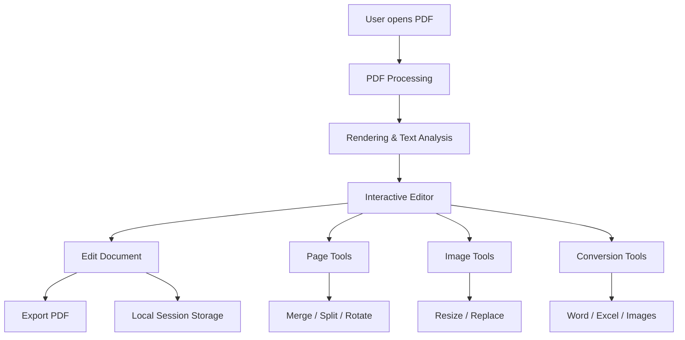

<div align="center">

# PDF Studio

### A browser-based PDF editor built for precise editing and privacy.

PDF Studio is a PDF workspace that brings editing, page management, conversions, and document tools together in one place. It runs directly in the browser, so documents can be processed locally without having to upload them to a server.

The goal was to build something more than a basic PDF viewer — a tool that makes working with PDFs easier while keeping the original document quality intact.

---

</div>

## Features

### Text editing
- Edit existing text directly within a PDF.
- Work with PDF text operators such as `Tj` and `TJ`.
- Preserve text positioning, baselines, and formatting as closely as possible.
- Combine fragmented text into more usable editing selections.

### Image editing
- Select embedded images, logos, and graphics.
- Move, resize, and replace images.
- Maintain aspect ratio while resizing.
- Adjust opacity and position.

### Page management
- Reorder pages with drag and drop.
- Rotate pages.
- Duplicate or delete pages.
- Insert blank pages.
- Merge multiple PDFs and split documents.

### Conversion tools
- Convert PDF content into Word documents.
- Export tables to Excel or CSV.
- Export pages as PNG or JPG.
- Download image exports in a ZIP archive.

### Additional tools
- Password protection and encryption.
- Flatten PDF documents.
- Add watermarks and stamps.
- Manage document pages and content.

### Responsive interface
PDF Studio is designed to work across different screen sizes, with a desktop workspace for detailed editing and a more touch-friendly layout for smaller devices.

---

## How it works

PDF Studio uses a combination of PDF parsing, rendering, and document editing libraries to handle different parts of the workflow.

| Component | Purpose |
|---|---|
| React 19 | User interface |
| Tailwind CSS | Styling and layout |
| pdfjs-dist | PDF rendering and text extraction |
| pdf-lib | PDF manipulation and exporting |
| WebAssembly | Browser-side processing support |
| IndexedDB | Local document session persistence |

The document is rendered for viewing, while editing operations are applied to the underlying PDF data where possible. This helps avoid the quality loss that comes with converting entire pages into images before editing.

The application also uses separate conversion workflows for document, spreadsheet, and image exports.

---

## Architecture



---

## Keyboard shortcuts

| Shortcut | Action |
|---|---|
| `V` | Select / Pointer tool |
| `E` | Edit existing text |
| `T` | Add text |
| `Space` | Hold to pan |
| `Arrow Keys` | Move selected element |
| `Shift + Arrow Keys` | Move selected element faster |
| `Ctrl / Cmd + D` | Duplicate selection |
| `Ctrl / Cmd + Z` | Undo |
| `Ctrl / Cmd + Y` | Redo |
| `Ctrl / Cmd + 0` | Reset zoom |
| `+ / -` | Zoom in / out |
| `Esc` | Deselect |

---

## Getting started

### Requirements

- Node.js 18.18+ or Node.js 20+
- npm or pnpm

### Installation

Clone the repository:

```bash
git clone https://github.com/DevDarsh26/PDF-Studio.git
cd PDF-Studio
```

Install dependencies:

```bash
npm install
```

Start the development server:

```bash
npm run dev
```

Open the local URL shown in your terminal — usually:

```text
http://localhost:3000
```

### Running tests

```bash
npm test
```

To run tests in watch mode:

```bash
npm run test:watch
```

### Production build

```bash
npm run build
npm run start
```

---

## Privacy

PDF Studio is designed around local document processing.

- Documents are processed within the browser.
- Files are not intentionally uploaded to a PDF processing server.
- Document sessions can be stored locally using IndexedDB.
- No document-processing backend is required for the core workflow.

The application may still load external libraries or other resources depending on its configuration. Local processing of a PDF does not necessarily mean the entire application is fully offline.

---

## License

Released under the MIT License. See [LICENSE](LICENSE) for details.

---

## Author

**Darsh Modi**

- Portfolio: [darshmodii.in](https://darshmodii.in)
- GitHub: [@DevDarsh26](https://github.com/DevDarsh26)

Built as an independent project to explore PDF rendering, document editing, browser-side processing, and the challenges of working with PDF internals.
